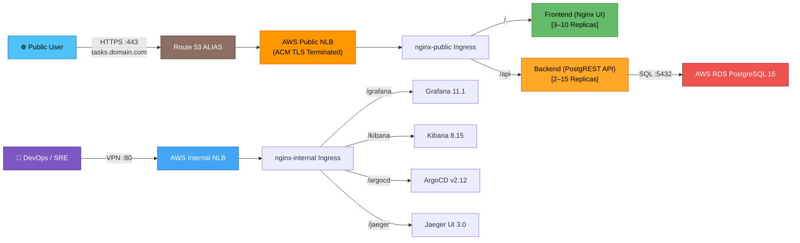
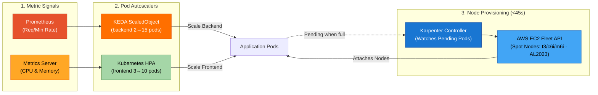
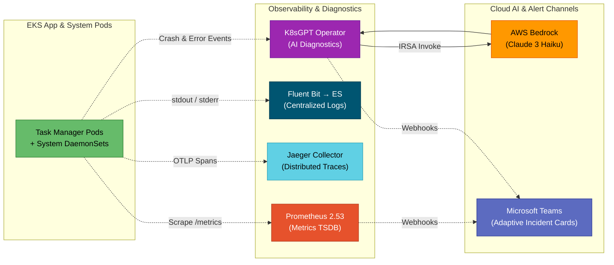
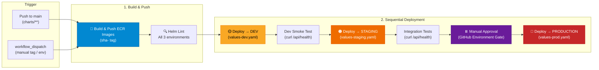

# EKS GitOps Platform — 3-Tier Production Architecture on AWS EKS

A production-grade, enterprise **EKS GitOps Platform** hosting a cloud-native 3-tier task manager application on **AWS EKS** with a fully automated **GitOps** pipeline using ArgoCD and multi-environment Helm charts.

## Architecture

### System Architecture Overview

The system is structured into **4 decoupled, secure tiers**: External Ingress & GitOps, Application Workloads (Karpenter Spot), Platform & Observability (On-Demand System Nodes), and AWS Managed Services.

```mermaid
graph TB
    User["🌐 User / Public Browser"]
    GitHub["📦 GitHub Repository\n(AdastraGE/eks-gitops-platform · main)"]
    Teams["📣 Microsoft Teams\n(CI/CD · GitOps · Alertmanager)"]
    DevOps["🔐 DevOps / SRE / VPN\n(Internal Tools Access)"]

    subgraph "AWS Cloud — us-east-1"

        subgraph "Dual Load Balancer Layer"
            PUB_NLB["☁️ Public AWS NLB\n(nginx-public · internet-facing)\n→ Public App Traffic (HTTPS via ACM)"]
            INT_NLB["🔒 Internal AWS NLB\n(nginx-internal · VPC-only CIDR)\n→ Internal Observability & GitOps"]
        end

        subgraph "Amazon EKS Cluster (v1.30 · System On-Demand + Karpenter Dynamic Spot)"

            subgraph "ingress-nginx Namespace (Dual Ingress Controllers)"
                ING_PUB["nginx-public Controller\n(ingressClassName: nginx-public)"]
                ING_INT["nginx-internal Controller\n(ingressClassName: nginx-internal)"]
                INT_ING["internal-tools-ingress\n(ingressClassName: nginx-internal)"]
                EXT_GRAF["grafana-external\n(ExternalName → monitoring)"]
                EXT_KB["kibana-external\n(ExternalName → logging)"]
                EXT_ARGO["argocd-external\n(ExternalName → argocd)"]
                EXT_JAEGER["jaeger-external\n(ExternalName → tracing)"]
            end

            subgraph "argocd Namespace (Helm: argo/argo-cd)"
                ArgoCD["🔄 ArgoCD Server\n(GitOps Controller v2.12 · ClusterIP)\nSubpath: /argocd"]
                ArgoNotif["🔔 ArgoCD Notifications\n(MS Teams webhook triggers)"]
            end

            subgraph "taskmanager Namespace (Application Tier)"
                direction TB
                TM_ING["ingress.yaml\n(nginx-public: / and /api→rewrite→/)"]
                subgraph "Frontend Tier"
                    FD["Frontend Pods\n(nginx:1.25-alpine)\n3–10 replicas · port 80"]
                    FS["frontend-svc\n(ClusterIP :80)"]
                    FE_HPA["📈 frontend-hpa\n(HPA: CPU 75% · Mem 80%)\nmin:3 → max:10 pods"]
                    FE_PDB["🛡️ frontend-pdb\n(minAvailable: 2)"]
                end
                subgraph "Backend Tier"
                    BD["Backend Pods\n(postgrest/postgrest:v12.2.3)\n2–15 replicas · port 3000"]
                    BS["backend-svc\n(ClusterIP :3000)"]
                    BE_SO["⚡ backend-scaledobject\n(KEDA: Prometheus req/min + CPU 70%)\nmin:2 → max:15 pods"]
                    BE_PDB["🛡️ backend-pdb\n(minAvailable: 1)"]
                end
                subgraph "Database Access"
                    PS["postgres-svc\n(ExternalName :5432 → RDS)"]
                end
                CM["ConfigMaps & Secrets\n(app-config · app-secret)"]
            end

            subgraph "kube-system Namespace (EKS Managed Add-ons)"
                VPC_CNI["🌐 AWS VPC CNI\n(Pod IP Allocation from VPC Subnets)"]
                COREDNS["🔎 CoreDNS\n(In-Cluster DNS & Service Discovery)"]
                KPROXY["🔀 kube-proxy\n(Node Network & Service Routing)"]
                EBS_CSI["💾 AWS EBS CSI Driver\n(ebs.csi.aws.com provisioner)"]
            end

            subgraph "Cluster Storage Layer"
                SC_GP3["📦 StorageClass: gp3\n(WaitForFirstConsumer · Retain · Expansion)\n→ Dynamic EBS gp3 Provisioning"]
            end

            subgraph "monitoring Namespace (Helm: kube-prometheus-stack)"
                PROM["📊 Prometheus 2.53\n(StatefulSet · 10Gi EBS gp3 TSDB)"]
                GRAF["📈 Grafana 11.1\n(Deployment · ClusterIP)\nSubpath: /grafana"]
                ALERT["🚨 Alertmanager 0.27\n(Deployment · 5Gi EBS gp3)"]
                NE["node-exporter\n(DaemonSet · Host Telemetry)"]
                KSM["kube-state-metrics\n(Deployment · K8s Objects)"]
            end

            subgraph "tracing Namespace (Helm: Jaeger Stack)"
                JAEGER_Q["🔭 Jaeger Query (Deployment)\n(Web UI :16686)\nSubpath: /jaeger — Reads from ES"]
                JAEGER_C["📡 Jaeger Collector (Deployment)\n(OTLP gRPC :4317 · HTTP :4318)\nStateless — writes spans to ES"]
                JAEGER_A["🔁 Jaeger Agent (DaemonSet)\n(per-node span batcher)\nRoutes spans → Collector"]
            end

            subgraph "amazon-cloudwatch Namespace"
                CWAgent["CloudWatch Agent DaemonSet\n(Prometheus EMF Scraper)"]
            end

            subgraph "logging Namespace (Helm: EFK Stack)"
                ES["Elasticsearch 8.15\n(StatefulSet · 10Gi EBS gp3)"]
                FB["Fluent Bit 3.1\n(DaemonSet · Log Collector)"]
                KB["Kibana 8.15\n(Deployment · ClusterIP)\nSubpath: /kibana"]
            end

            subgraph "k8sgpt Namespace (Helm: k8sgpt-operator)"
                K8SGPT["🤖 K8sGPT Operator\n(AI-Powered SRE Engine)\nIRSA Role: Claude 3 Haiku"]
            end

            subgraph "keda Namespace (Helm: kedacore/keda)"
                KEDA_CTRL["⚡ KEDA Controller\n(2 replicas · event-driven pod scaler)\nPrometheus ScaledObject triggers"]
                METRICS_SRV["📊 Kubernetes Metrics Server\n(CPU/Memory telemetry for HPA)"]
            end

            subgraph "Karpenter Dynamic Node Pool (AWS EC2 Fleet)"
                KP_CTRL["🚀 Karpenter Controller\n(kube-system · 2 replicas · IRSA)\nProvisions EC2 in < 45 seconds"]
                KP_NP["NodePool: app-nodepool\n(Spot→On-Demand fallback)\nt3/c6i/m6i · AL2023 AMI · 100 vCPU limit"]
                KP_INTR["📬 SQS Interruption Queue\n+ 3× EventBridge Rules\n(2-min Spot warning handler)"]
            end
        end

        subgraph "AWS Managed Services"
            RDS["🗄️ AWS RDS PostgreSQL 15\n(db.t4g.micro · Single-AZ)\nDB: taskdb · port 5432 · sslmode=require"]
            ECR["📦 AWS ECR\n(taskmanager-frontend · taskmanager-backend)\nImage registry for CI/CD builds"]
            R53["🌐 Route 53 Hosted Zone\n(DNS ALIAS A-Record → Public NLB)"]
            ACM["🔒 AWS Certificate Manager\n(ACM SSL/TLS · DNS validation)\ntasks.yourdomain.com"]
            CWLogs["CloudWatch Logs\n(/aws/containerinsights/prometheus)\n(/aws/containerinsights/performance)"]
            CWDash["CloudWatch Dashboard & Alarms\n(taskmanager-cluster-observability)\nAlarms: RDS CPU > 80% · Storage < 2 GB"]
            Bedrock["🧠 AWS Bedrock\n(Anthropic Claude 3 Haiku)\nModel: claude-3-haiku-20240307-v1:0"]
        end
    end

    %% GitOps Continuous Delivery flow
    GitHub -->|"git push to main"| ArgoCD
    ArgoCD -->|"auto-sync manifests"| TM_ING
    ArgoCD -->|"auto-sync manifests"| FS
    ArgoCD -->|"auto-sync manifests"| BS
    ArgoCD --> ArgoNotif
    ArgoNotif -->|"Sync / Health Alerts (Webhook)"| Teams
    GitHub -..->|"CI/CD Plan / Apply / Destroy Alerts"| Teams

    %% PUBLIC TRAFFIC FLOW
    User -->|"HTTPS :443 (tasks.domain.com)"| R53
    R53 -->|"ALIAS A-Record"| PUB_NLB
    ACM -..->|"TLS termination"| PUB_NLB
    PUB_NLB --> ING_PUB
    ING_PUB --> TM_ING
    TM_ING -->|"Path: / (Frontend UI)"| FS
    TM_ING -->|"Path: /api (REST API)"| BS
    FS --> FD
    BS --> BD

    %% INTERNAL TRAFFIC FLOW
    DevOps -->|"VPN / SSM / Port-Forward"| INT_NLB
    INT_NLB --> ING_INT
    ING_INT --> INT_ING
    INT_ING -->|"Path: /grafana"| EXT_GRAF
    INT_ING -->|"Path: /kibana"| EXT_KB
    INT_ING -->|"Path: /argocd"| EXT_ARGO
    INT_ING -->|"Path: /jaeger"| EXT_JAEGER
    EXT_GRAF -->|"kube-prometheus-stack-grafana:80"| GRAF
    EXT_KB -->|"kibana-kibana:5601"| KB
    EXT_ARGO -->|"argocd-server:80"| ArgoCD
    EXT_JAEGER -->|"jaeger-query:16686"| JAEGER_Q

    BD -->|"PGRST_DB_URI (Port 5432)"| PS
    PS -->|"ExternalName DNS"| RDS

    CM -..->|"Environment variables"| FD
    CM -..->|"Environment variables"| BD

    EBS_CSI -->|"powers provisioner"| SC_GP3
    SC_GP3 -..->|"10Gi PVC dynamic volume"| PROM
    SC_GP3 -..->|"5Gi PVC dynamic volume"| ALERT
    SC_GP3 -..->|"10Gi PVC dynamic volume"| ES

    NE -..->|"Node hardware metrics"| PROM
    KSM -..->|"Kubernetes object states"| PROM
    BD -..->|"PostgREST metrics (/metrics)"| PROM
    FD -..->|"Container metrics"| PROM
    PROM -->|"PromQL query API"| GRAF
    PROM -->|"Alerting rules evaluation"| ALERT
    ALERT -->|"Firing / Resolved alerts (Webhook)"| Teams

    JAEGER_A -..->|"batches spans"| JAEGER_C
    JAEGER_C -->|"Bulk writes traces (ES Index API)"| ES
    JAEGER_Q -->|"Reads trace data (ES Search API)"| ES

    BD -..->|"Prometheus /metrics"| CWAgent
    CWAgent -->|"EMF Structured Logs"| CWLogs
    CWLogs --> CWDash

    FD -..->|"stdout / stderr"| FB
    BD -..->|"stdout / stderr"| FB
    FB -->|"HTTP Bulk Ingestion"| ES
    ES -->|"Search & Query API"| KB

    FD -..->|"Failure logs / CrashEvents"| K8SGPT
    BD -..->|"Failure logs / CrashEvents"| K8SGPT
    K8SGPT -->|"bedrock:InvokeModel (IRSA)"| Bedrock
    Bedrock -->|"AI Root Cause & Fix Commands"| K8SGPT
    K8SGPT -->|"AI Incident Diagnosis (Webhook)"| Teams

    PROM -..->|"PromQL req/min metric"| KEDA_CTRL
    KEDA_CTRL -..->|"Drives HPA replica count"| BE_SO
    METRICS_SRV -..->|"CPU/Mem telemetry"| FE_HPA
    METRICS_SRV -..->|"CPU/Mem telemetry"| BE_SO
    BE_SO -..->|"Scales 2→15 pods"| BD
    FE_HPA -..->|"Scales 3→10 pods"| FD
    BE_PDB -..->|"Guards during drain"| BD
    FE_PDB -..->|"Guards during drain"| FD
    BD -..->|"Pending pods trigger"| KP_CTRL
    FD -..->|"Pending pods trigger"| KP_CTRL
    KP_CTRL -->|"EC2 Fleet API (< 45s)"| KP_NP
    KP_INTR -..->|"Spot 2-min warning"| KP_CTRL

    style User fill:#4FC3F7,stroke:#0277BD,color:#000
    style DevOps fill:#7B68EE,stroke:#4B0082,color:#fff
    style GitHub fill:#24292E,stroke:#586069,color:#fff
    style Teams fill:#6264A7,stroke:#464775,color:#fff
    style PUB_NLB fill:#FF9900,stroke:#232F3E,color:#000
    style INT_NLB fill:#5C6BC0,stroke:#283593,color:#fff
    style ING_PUB fill:#326CE5,stroke:#1A4DB5,color:#fff
    style ING_INT fill:#283593,stroke:#1A237E,color:#fff
    style INT_ING fill:#3F51B5,stroke:#1A237E,color:#fff
    style EXT_GRAF fill:#CE93D8,stroke:#6A1B9A,color:#000
    style EXT_KB fill:#CE93D8,stroke:#6A1B9A,color:#000
    style EXT_ARGO fill:#CE93D8,stroke:#6A1B9A,color:#000
    style EXT_JAEGER fill:#CE93D8,stroke:#6A1B9A,color:#000
    style ArgoCD fill:#EF7B4D,stroke:#C04A1A,color:#fff
    style ArgoNotif fill:#F4A261,stroke:#C04A1A,color:#000
    style TM_ING fill:#326CE5,stroke:#1A4DB5,color:#fff
    style FD fill:#66BB6A,stroke:#2E7D32,color:#000
    style FS fill:#A5D6A7,stroke:#2E7D32,color:#000
    style BD fill:#FFA726,stroke:#E65100,color:#000
    style BS fill:#FFCC80,stroke:#E65100,color:#000
    style PS fill:#CE93D8,stroke:#6A1B9A,color:#000
    style CM fill:#78909C,stroke:#37474F,color:#fff
    style RDS fill:#EF5350,stroke:#B71C1C,color:#fff
    style VPC_CNI fill:#00897B,stroke:#004D40,color:#fff
    style COREDNS fill:#00897B,stroke:#004D40,color:#fff
    style KPROXY fill:#00897B,stroke:#004D40,color:#fff
    style EBS_CSI fill:#00897B,stroke:#004D40,color:#fff
    style SC_GP3 fill:#8E24AA,stroke:#4A148C,color:#fff
    style PROM fill:#E6522C,stroke:#B13A1E,color:#fff
    style GRAF fill:#F5A623,stroke:#C07D10,color:#000
    style ALERT fill:#D63B25,stroke:#9B2A1C,color:#fff
    style NE fill:#E6522C,stroke:#B13A1E,color:#fff
    style KSM fill:#E6522C,stroke:#B13A1E,color:#fff
    style JAEGER_Q fill:#60D0E4,stroke:#2BA0B5,color:#000
    style JAEGER_C fill:#4DB6C8,stroke:#2BA0B5,color:#000
    style JAEGER_A fill:#80DEEA,stroke:#2BA0B5,color:#000
    style CWAgent fill:#FF9900,stroke:#232F3E,color:#fff
    style CWLogs fill:#FFE0B2,stroke:#E65100,color:#000
    style CWDash fill:#FF9900,stroke:#232F3E,color:#000
    style Bedrock fill:#FF9900,stroke:#232F3E,color:#000
    style ES fill:#005571,stroke:#003A4D,color:#fff
    style FB fill:#49BDA5,stroke:#2D8F7B,color:#000
    style KB fill:#E8478B,stroke:#C12D6B,color:#fff
    style K8SGPT fill:#9C27B0,stroke:#6A1B9A,color:#fff
    style KEDA_CTRL fill:#FF6F00,stroke:#E65100,color:#fff
    style METRICS_SRV fill:#FFA726,stroke:#E65100,color:#000
    style KP_CTRL fill:#1565C0,stroke:#0D47A1,color:#fff
    style KP_NP fill:#42A5F5,stroke:#1565C0,color:#000
    style KP_INTR fill:#90CAF9,stroke:#1565C0,color:#000
    style FE_HPA fill:#A5D6A7,stroke:#2E7D32,color:#000
    style FE_PDB fill:#C8E6C9,stroke:#2E7D32,color:#000
    style BE_SO fill:#FFCC80,stroke:#E65100,color:#000
    style BE_PDB fill:#FFE0B2,stroke:#E65100,color:#000
    style R53 fill:#8D6E63,stroke:#4E342E,color:#fff
    style ACM fill:#66BB6A,stroke:#2E7D32,color:#000
    style ECR fill:#FF9900,stroke:#232F3E,color:#000
```



### Detailed Domain Workflows

#### 🌐 1. Application & Dual Ingress Traffic Flow


#### ⚡ 2. Full-Stack Autoscaling & Node Provisioning Flow


#### 🔭 3. Observability, AI SRE & GitOps Alerting Flow


#### 🚀 4. Multi-Environment CI/CD Deployment Flow


---

### Architecture Highlights

1. **Dual Ingress Segmentation & Cross-Namespace `ExternalName` Proxies:**
   - **Public NLB (`nginx-public`)**: Internet-facing load balancer serving the Frontend UI (`/`) and PostgREST backend API (`/api`). TLS terminated at the NLB via ACM certificate when `ssl_enabled = true`.
   - **Internal NLB (`nginx-internal`)**: Private VPC load balancer serving **Grafana** (`/grafana`), **Kibana** (`/kibana`), **ArgoCD** (`/argocd`), and **Jaeger** (`/jaeger`).
   - **Cross-Namespace ExternalName Services**: Ingress rules in `ingress-nginx` route through dedicated `ExternalName` proxy services (`grafana-external`, `kibana-external`, `argocd-external`, `jaeger-external`) that resolve target service FQDNs across namespaces (`monitoring`, `logging`, `argocd`, `tracing`).
2. **Automated HTTPS via ACM + Route 53 (`ssl.tf`):**
   - Terraform automatically provisions a **Route 53 Hosted Zone**, requests a free **AWS Certificate Manager (ACM)** TLS certificate, inserts DNS CNAME validation records, and creates a Route 53 **ALIAS A-Record** pointing `tasks.yourdomain.com → Public NLB`. TLS is terminated at the NLB layer for zero pod overhead. Controlled by `ssl_enabled` variable.
3. **EKS Core Add-ons & Dynamic `gp3` Storage Layer:**
   - **AWS-Managed Add-ons**: `vpc-cni` (direct VPC IP allocation per pod), `coredns` (cluster DNS discovery), `kube-proxy` (node networking), and `aws-ebs-csi-driver` (dynamic storage provisioner).
   - **StorageClass (`gp3`)**: Configured with `volume_binding_mode = "WaitForFirstConsumer"` to ensure EBS volumes are created in the exact Availability Zone of the scheduled pod, with `allow_volume_expansion = true` and `reclaim_policy = "Retain"`. Powers persistent storage for **Elasticsearch (`10Gi`)**, **Prometheus TSDB (`10Gi`)**, and **Alertmanager (`5Gi`)**.
4. **Automated GitOps Engine (ArgoCD via Helm):**
   - Fully provisioned by Terraform. Automatically synchronizes `charts/taskmanager` Helm charts from GitHub (`AdastraGE/eks-gitops-platform`) into the `taskmanager` namespace with self-healing and auto-pruning.
5. **Triple-Layer Alerting System (Microsoft Teams Webhook):**
   - **CI/CD Pipeline Alerts**: GitHub Actions emits Rich Adaptive Cards for Terraform Plan, Apply, and Destroy events.
   - **GitOps Alerts**: ArgoCD Notifications publishes real-time sync success, sync failure, and health degradation cards.
   - **Infrastructure / Metric Alerts**: Alertmanager routes Prometheus alert rule evaluations (pod crashes, replica mismatches, node pressure) directly to Teams.
6. **Complete 3-Pillar Observability Stack (Metrics, Logs, Traces):**
   - **Metrics (Prometheus & Grafana)**: Time-series metrics across nodes, Kubernetes objects, and PostgREST endpoints with persistent EBS `gp3` TSDB storage.
   - **Logs (EFK Stack)**: Distributed log aggregation via Fluent Bit DaemonSets into Elasticsearch with visualization in Kibana.
   - **Traces (Jaeger)**: End-to-end distributed tracing via three distinct workloads — **Jaeger Collector** (`Deployment`, ingests OTLP spans on ports 4317/4318), **Jaeger Query UI** (`Deployment`, serves the `/jaeger` dashboard at port 16686), and **Jaeger Agent** (`DaemonSet`, per-node batcher routing spans to the Collector). All traces are persisted in Elasticsearch (not in Jaeger itself), so Jaeger components are fully stateless and do NOT require PersistentVolumes.
   - **AWS CloudWatch Container Insights**: Embedded Metric Format (EMF) scraping for cloud-native metrics and alarms.
7. **AI-Powered SRE Automation (K8sGPT + AWS Bedrock):**
   - Autonomous Kubernetes failure detection across pods, deployments, services, ingress, PVCs, and nodes.
   - Leverages **AWS Bedrock (Anthropic Claude 3 Haiku)** via **IAM Roles for Service Accounts (IRSA)** for passwordless, zero-secret authentication, delivering plain-English root causes and remediation `kubectl` commands directly to Microsoft Teams.
8. **Dual Managed Node Groups (Workload Isolation & Spot Cost Optimization):**
   - **`system_nodes`** (`ON_DEMAND`, 2x `t3.medium`): High-reliability node group hosting Ingress controllers, ArgoCD, Prometheus, Grafana, Alertmanager, Elasticsearch, Kibana, Jaeger, K8sGPT Operator, KEDA Controller, and the Karpenter controller itself.
   - **`app_nodes` → Karpenter `NodePool`**: Cost-optimized dynamic compute pool for `taskmanager` application workloads. Karpenter provisions right-sized Spot instances (with On-Demand fallback) from families `t3`, `t3a`, `c6i`, `m6i` using **Amazon Linux 2023 (AL2023)** AMI within 45 seconds when pods become `Pending`; auto-consolidates and terminates idle nodes.
9. **Full-Stack Autoscaling Engine (KEDA + HPA + Karpenter):**
   - **Pod-Level — KEDA (Event-Driven)**: `ScaledObject` on the backend drives HPA scaling from **2 → 15 replicas** based on dual triggers: Prometheus PostgREST request rate (`> 50 req/min per pod`) and CPU utilization (`> 70%`).
   - **Pod-Level — HPA (Resource-Based)**: Standard Kubernetes HPA scales frontend from **3 → 10 replicas** on CPU (`> 75%`) and Memory (`> 80%`); powered by Kubernetes Metrics Server.
   - **Node-Level — Karpenter**: Automatically provisions EC2 Spot/On-Demand nodes from AWS EC2 Fleet API in **< 45 seconds** when scaling pods are `Pending`. Handles Spot interruption warnings (2-minute SQS/EventBridge signal) with graceful node draining. Consolidates underutilized nodes after 30 seconds idle.
   - **Resilience — PodDisruptionBudgets (PDBs)**: Guarantee `minAvailable: 2` for frontend and `minAvailable: 1` for backend during any Karpenter node consolidation or EC2 reclaim, ensuring zero user-facing downtime.
10. **Multi-Environment Helm Chart (`charts/taskmanager`):**
    - A single parameterized Helm chart with environment-specific values files (`values-dev.yaml`, `values-staging.yaml`, `values-prod.yaml`) that override replica counts, resource requests, image tags, autoscaling settings, TLS configuration, and Karpenter instance types per environment.

## Tech Stack

| Layer | Technology |
|---|---|
| **Container Orchestration** | AWS EKS 1.30 (`system_nodes` [ON_DEMAND `t3.medium`] + Karpenter Dynamic NodePool [Spot `t3/c6i/m6i` · AL2023 AMI]) |
| **EKS Managed Add-ons** | `vpc-cni`, `coredns`, `kube-proxy`, `aws-ebs-csi-driver` |
| **Persistent Storage** | Kubernetes `gp3` StorageClass (`WaitForFirstConsumer`, EBS CSI provisioner) |
| **Frontend** | Nginx serving static HTML/CSS/JS (ECR image: `taskmanager-frontend`) |
| **Backend API** | [PostgREST](https://postgrest.org/) v12.2.3 — auto-generates REST API from PostgreSQL schema (ECR image: `taskmanager-backend`) |
| **Database** | AWS RDS PostgreSQL 15 (`db.t4g.micro`, Single-AZ) |
| **GitOps** | ArgoCD v2.12 — Helm-managed, fully automated via `terraform apply` |
| **CI/CD — Infrastructure** | GitHub Actions (`terraform.yml`) — Terraform plan/apply pipeline with OIDC authentication |
| **CI/CD — Application** | GitHub Actions (`deploy.yml`) — Build & push ECR images, sequential Helm deploy: Dev → Staging → Production with smoke/integration tests and manual approval gate |
| **CI/CD — Unified Dev Pipeline** | GitHub Actions (`dev-pipeline.yml`) — Single end-to-end pipeline: Lint & Validate → Terraform Apply (Dev) → GitOps Sync via ArgoCD (`k8s/*.yaml`) → Smoke Tests |
| **Container Registry** | AWS ECR (`taskmanager-frontend`, `taskmanager-backend`) — OIDC-authenticated pushes from GitHub Actions |
| **Helm Chart** | `charts/taskmanager` (v1.0.0) — multi-environment values: `values-dev.yaml`, `values-staging.yaml`, `values-prod.yaml` |
| **Ingress** | Dual Nginx Ingress Controllers — `nginx-public` (internet, v4.10.1) + `nginx-internal` (VPC-only, v4.10.1) |
| **SSL / TLS** | AWS Certificate Manager (ACM) + Route 53 — automated DNS validation, ALIAS A-record, NLB TLS termination (controlled by `ssl_enabled`) |
| **Event-Driven Pod Autoscaling** | KEDA v2.15 — Prometheus request-rate + CPU triggers on backend (`ScaledObject`, min:2 → max:15) |
| **Resource-Based Pod Autoscaling** | Kubernetes HPA v2 — CPU/Memory triggers on frontend (min:3 → max:10) via Metrics Server |
| **Node Autoscaling** | Karpenter v1.0.8 — just-in-time EC2 Spot/On-Demand provisioning (< 45s), AL2023 AMI, Spot interruption via SQS + EventBridge, node consolidation |
| **Resilience** | PodDisruptionBudgets — `minAvailable: 2` (frontend) + `minAvailable: 1` (backend) |
| **Metrics & Monitoring** | Prometheus 2.53 + Grafana 11.1 via `kube-prometheus-stack` (Helm-managed) |
| **Distributed Tracing** | Jaeger 3.0 via `jaegertracing/jaeger` (chart v3.0.12) — Collector, Query UI, Agent (`DaemonSet`); traces stored in Elasticsearch |
| **Alerting** | Alertmanager (MS Teams webhook routing) + AWS CloudWatch Alarms |
| **Observability (AWS)** | AWS CloudWatch (Dashboard + Container Insights + Metric Alarms) |
| **Centralized Logging** | EFK Stack — Elasticsearch 8.15, Fluent Bit 3.1, Kibana 8.15 (Helm-managed via Terraform) |
| **AI SRE / AIOps** | K8sGPT Operator 0.2.2 + AWS Bedrock (Anthropic Claude 3 Haiku via IRSA) |
| **Infrastructure as Code** | Terraform >= 1.6.0 (S3 backend + DynamoDB state locking) |


## Project Structure

```
├── k8s/                              # Raw Kubernetes manifests (reference templates)
│   ├── namespace.yaml                # taskmanager namespace
│   ├── secret.yaml                   # App secrets (RDS credentials, PGRST_DB_URI)
│   ├── configmap.yaml                # PostgREST configuration (schema, anon role)
│   ├── frontend-configmap.yaml       # Frontend HTML/CSS/JS (served via Nginx)
│   ├── frontend-deployment.yaml
│   ├── frontend-service.yaml         # type: ClusterIP — traffic enters via nginx Ingress only
│   ├── frontend-hpa.yaml             # HPA: CPU 75% + Memory 80% → scales frontend 3→10 pods
│   ├── backend-deployment.yaml       # PostgREST deployment
│   ├── backend-service.yaml          # type: ClusterIP
│   ├── backend-scaledobject.yaml     # KEDA ScaledObject: Prometheus req/min + CPU → scales backend 2→15 pods
│   ├── pdb.yaml                      # PodDisruptionBudgets (frontend minAvail:2 + backend minAvail:1)
│   ├── postgres-service.yaml         # type: ExternalName → AWS RDS endpoint
│   ├── karpenter-nodepool.yaml       # Karpenter EC2NodeClass (AL2023) + NodePool (Spot→On-Demand, auto-consolidation)
│   ├── ingress.yaml                  # Public Ingress (nginx-public: / → frontend, /api → backend)
│   └── ingress-internal.yaml         # Internal Ingress (nginx-internal: /grafana, /kibana, /argocd, /jaeger)
│
├── charts/                           # Helm chart for multi-environment deployments (synced by ArgoCD & CI/CD)
│   └── taskmanager/
│       ├── Chart.yaml                # Chart metadata (name: taskmanager, version: 1.0.0)
│       ├── values.yaml               # Base defaults shared across all environments
│       ├── values-dev.yaml           # DEV overrides: single replicas, burstable images, dev RDS
│       ├── values-staging.yaml       # STAGING overrides: 2 replicas, staging RDS, integration TLS
│       ├── values-prod.yaml          # PROD overrides: 3+ replicas, HPA + KEDA, On-Demand Karpenter, ACM TLS
│       └── templates/                # Helm templates (deployment, service, ingress, HPA, KEDA, PDB, etc.)
│
├── terraform/                        # Infrastructure as Code
│   ├── provider.tf                   # AWS + Kubernetes + Helm + Random provider config (requires >= 1.6.0)
│   ├── variables.tf                  # All configurable inputs (EFK, Monitoring, ArgoCD, Tracing, SSL, Karpenter, KEDA vars)
│   ├── vpc.tf                        # VPC, public/private subnets, NAT Gateway
│   ├── eks.tf                        # EKS cluster + system_nodes (ON_DEMAND) + EBS CSI IRSA
│   ├── rds.tf                        # RDS PostgreSQL instance + subnet/security groups
│   ├── secret.tf                     # Kubernetes Secret (app-secret) created by Terraform — DB credentials injected into pods
│   ├── ssl.tf                        # HTTPS automation: Route 53 Hosted Zone + ACM certificate + DNS validation + NLB ALIAS record
│   ├── cloudwatch.tf                 # CloudWatch Log Groups, Dashboard, Metric Alarms
│   ├── ingress.tf                    # Dual Nginx Ingress Controllers (nginx-public v4.10.1 + nginx-internal v4.10.1)
│   ├── efk.tf                        # EFK logging stack (Helm: ES + Fluent Bit + Kibana)
│   ├── monitoring.tf                 # Prometheus + Grafana stack (Helm: kube-prometheus-stack)
│   ├── tracing.tf                    # Jaeger distributed tracing stack (Helm: jaegertracing/jaeger v3.0.12)
│   ├── argocd.tf                     # ArgoCD GitOps controller (Helm: argo/argo-cd)
│   ├── k8sgpt.tf                     # K8sGPT Operator (AI-powered SRE via AWS Bedrock + IRSA)
│   ├── karpenter.tf                  # Karpenter: IRSA + Node IAM Role + SQS queue + EventBridge + Helm
│   ├── keda.tf                       # KEDA Controller + Kubernetes Metrics Server (Helm)
│   └── outputs.tf                    # Key outputs (endpoints, commands, passwords)
│
└── .github/
    └── workflows/
        ├── dev-pipeline.yml          # CI/CD: Unified Dev deployment (Terraform infra + ArgoCD GitOps k8s/ sync + Smoke tests)
        ├── terraform.yml             # CI/CD: Terraform plan on PR, auto-apply on push to main, manual plan/apply
        └── deploy.yml                # CI/CD: Build & push ECR images → Deploy Dev → Staging → Prod (sequential)
```

## Prerequisites

- AWS CLI configured with appropriate credentials (`aws configure`)
- [Terraform](https://developer.hashicorp.com/terraform/install) >= **1.6.0**
- [kubectl](https://kubernetes.io/docs/tasks/tools/)
- [Helm](https://helm.sh/docs/intro/install/) >= v3.15

## Quick Start

### 1. Clone Repository & Deploy Infrastructure

```bash
# Clone the repository
git clone https://github.com/AdastraGE/eks-gitops-platform.git
cd eks-gitops-platform/terraform

# Initialize and apply Terraform
terraform init
terraform apply
```

This provisions:
- EKS cluster (`taskmanager-cluster`) with **On-Demand System Node Group** + **Karpenter Just-in-Time Spot NodePool** (AL2023 AMI)
- AWS RDS PostgreSQL 15 (`db.t4g.micro`)
- VPC with public/private subnets across 2 AZs
- **Route 53 Hosted Zone + ACM SSL certificate + DNS alias** (when `ssl_enabled = true`)
- CloudWatch Dashboard + Metric Alarms + Container Insights
- Kubernetes Secret (`app-secret`) with RDS credentials — managed by Terraform (`secret.tf`)
- **EFK Logging Stack** via Helm (Elasticsearch 8.15, Fluent Bit 3.1, Kibana 8.15)
- **Prometheus + Grafana + Alertmanager Monitoring Stack** via Helm
- **Jaeger Distributed Tracing Stack** via Helm (connected to Elasticsearch backend)
- **K8sGPT Operator** with AWS Bedrock AI incident analysis
- **KEDA + Kubernetes Metrics Server + Karpenter** full-stack autoscaling engine

### 2. Configure kubectl

```bash
aws eks update-kubeconfig --region us-east-1 --name taskmanager-cluster
```

### 3. Update RDS Endpoint in postgres-service.yaml

After `terraform apply`, update the `externalName` in [k8s/postgres-service.yaml](k8s/postgres-service.yaml) with the actual RDS endpoint:

```bash
# Get the RDS address
terraform output rds_address

# Or patch it directly
terraform output rds_k8s_external_service_command | bash
```

### 4. Initialize the Database Schema

Run a one-off pod to create the `tasks` table and `web_anon` role on RDS:

```bash
kubectl run rds-init -n taskmanager --image=postgres:15-alpine --rm -i --restart=Never -- \
  psql "postgres://postgres:<PASSWORD>@<RDS_HOST>:5432/taskdb?sslmode=require" -c "
    CREATE ROLE web_anon NOLOGIN;
    GRANT USAGE ON SCHEMA public TO web_anon;
    CREATE TABLE IF NOT EXISTS tasks (
      id SERIAL PRIMARY KEY,
      title VARCHAR(255) NOT NULL,
      description TEXT,
      status VARCHAR(50) NOT NULL DEFAULT 'pending',
      created_at TIMESTAMPTZ DEFAULT NOW(),
      updated_at TIMESTAMPTZ DEFAULT NOW()
    );
    GRANT ALL ON TABLE tasks TO web_anon;
    GRANT USAGE, SELECT ON ALL SEQUENCES IN SCHEMA public TO web_anon;"
```

> [!NOTE]
> The Kubernetes Secret (`app-secret`) containing the `PGRST_DB_URI` is automatically created by Terraform (`terraform/secret.tf`) using the RDS endpoint and `db_password` variable. Manual base64 encoding is no longer needed.

### 5. ArgoCD (GitOps) & MS Teams Alerts

ArgoCD is **100% automated via Helm** (`terraform/argocd.tf`). When `terraform apply` completes:
1. ArgoCD Server & Controllers are running in the `argocd` namespace.
2. MS Teams notifications are configured and subscribed to sync events.
3. The `taskmanager` Application is auto-created and syncing the `charts/taskmanager` directory.

**Get the auto-generated admin password:**
```bash
kubectl -n argocd get secret argocd-initial-admin-secret -o jsonpath="{.data.password}" | base64 -d
```

**Access the ArgoCD UI:**
```bash
# Option A: Via Internal Ingress Controller port-forward
kubectl port-forward svc/nginx-internal-ingress-nginx-controller 8080:80 -n ingress-nginx
# Open http://localhost:8080/argocd (username: admin)

# Option B: Direct port-forward
kubectl port-forward svc/argocd-server 8080:80 -n argocd
# Open http://localhost:8080 (username: admin)
```

### 6. Push Changes to GitHub to Sync

Any changes committed and pushed to the `charts/taskmanager/` directory on the `main` branch will be **automatically synced** by ArgoCD within ~3 minutes and send a notification card directly to Microsoft Teams.

## Accessing the Application

### Via HTTPS (Custom Domain — `ssl_enabled = true`)

```bash
# Output the public URL
terraform output app_url
# → https://tasks.yourdomain.com
```

- **Frontend Web UI**: `https://tasks.yourdomain.com/`
- **Backend REST API**: `https://tasks.yourdomain.com/api/tasks`

> [!IMPORTANT]
> You must update your domain registrar to point nameservers to the Route 53 Hosted Zone NS records before the ACM certificate can be validated and the alias record resolves.

### Via Public NLB Hostname (No Custom Domain)

```bash
# Get the Public Ingress Controller's external NLB hostname
kubectl get svc nginx-public-ingress-nginx-controller -n ingress-nginx \
  -o jsonpath='{.status.loadBalancer.ingress[0].hostname}'
```

- **Frontend Web UI**: `http://<PUBLIC-NLB-HOSTNAME>/`
- **Backend REST API**: `http://<PUBLIC-NLB-HOSTNAME>/api/tasks`

### Port-Forward (Local Development)

```bash
# Frontend
kubectl port-forward svc/frontend-svc 8080:80 -n taskmanager
# Open http://localhost:8080

# Backend REST API
kubectl port-forward svc/backend-svc 3000:3000 -n taskmanager
# Open http://localhost:3000/tasks
```

## Key Design Decisions

| Decision | Rationale |
|---|---|
| **PostgREST as Backend** | Auto-generates a full REST API from PostgreSQL schema — zero backend code to maintain |
| **AWS RDS (not in-cluster Postgres)** | Managed, automated backups, Multi-AZ failover capability, separate lifecycle from EKS |
| **ExternalName Service for RDS** | Backend pods connect via `postgres-svc:5432` — no hardcoded DNS, easy to swap |
| **Dual Nginx Ingress Controllers** | `nginx-public` (internet-facing NLB) separates public app traffic from `nginx-internal` (VPC-only NLB) which serves admin tools — zero attack surface on Grafana, Kibana, ArgoCD |
| **Native K8s Ingress (no Istio)** | Eliminates sidecar overhead (~100–150 MB RAM/CPU per pod), removes webhook deadlock risk |
| **ExternalName proxy pattern** | `ingress-internal.yaml` uses `ExternalName` services in the `ingress-nginx` namespace to reach ClusterIP services across namespaces without exposing them |
| **ACM + Route 53 for TLS** | Free managed TLS certificate with automated DNS validation. TLS terminated at the NLB layer — zero certificate rotation overhead on pods. Controlled by `ssl_enabled` variable for cost-free dev environments |
| **Terraform-managed Kubernetes Secret** | DB credentials injected via `terraform/secret.tf` using the `kubernetes_secret` resource — no manual `base64` encoding, no plaintext secrets in git |
| **ArgoCD via Helm (not raw YAML)** | Zero manual `kubectl apply` steps — MS Teams notifications, app provisioning and namespace creation all automated via `terraform apply` |
| **`sslmode=require` in DB URI** | AWS RDS enforces TLS by default; this ensures encrypted connections from PostgREST |
| **Dual Managed Node Groups** | `system_nodes` (`ON_DEMAND` `t3.medium`) for core infra/observability + Karpenter `SPOT` pool for stateless app workloads saves ~70% on compute |
| **EFK via Helm (not raw YAML)** | Official Helm charts (elastic/elasticsearch, fluent/fluent-bit, elastic/kibana) — production-grade with upgradeable chart versions, parameterized via Terraform variables |
| **Multi-env Helm chart** | Single `charts/taskmanager` chart parameterized by `values-dev/staging/prod.yaml` — same chart, different resource profiles, image tags, and autoscaling behavior per environment |
| **Sequential CI/CD pipeline** | `deploy.yml` gates staging on dev smoke tests and gates prod on staging integration tests + manual approval — prevents broken images from reaching production |
| **AL2023 AMI for Karpenter nodes** | Amazon Linux 2023 is the modern, security-hardened EKS-optimized AMI (replaces AL2). Better boot performance and smaller attack surface |

## SSL / HTTPS Configuration

When `ssl_enabled = true` (default), Terraform (`terraform/ssl.tf`) automates the full HTTPS setup:

1. **Route 53 Hosted Zone** — created for `var.domain_name` (e.g., `yourdomain.com`)
2. **ACM Certificate** — issued for `var.app_subdomain.var.domain_name` (e.g., `tasks.yourdomain.com`) with DNS validation
3. **DNS CNAME Validation Records** — automatically inserted into Route 53 so ACM can validate and issue the certificate without manual steps
4. **Certificate Validation Waiter** — Terraform blocks further resource creation until ACM marks the certificate as `ISSUED`
5. **Route 53 ALIAS A-Record** — points `tasks.yourdomain.com` → Public NLB hostname (free, auto-updates when NLB DNS changes)
6. **NLB TLS Termination** — the Public NLB is annotated with the ACM certificate ARN; TLS 1.3 policy (`ELBSecurityPolicy-TLS13-1-2-2021-06`) is enforced

### Required Variables for SSL

```bash
terraform apply \
  -var="domain_name=yourdomain.com" \
  -var="app_subdomain=tasks" \
  -var="ssl_enabled=true"
```

### Disable SSL (Dev / Cost Saving)

```bash
terraform apply -var="ssl_enabled=false"
```

> [!IMPORTANT]
> Before running `terraform apply` with `ssl_enabled=true`, point your domain's NS records to the Route 53 Hosted Zone nameservers. ACM DNS validation will fail if Route 53 cannot resolve the CNAME records publicly.

## Multi-Environment Application Deployment

The project uses a Helm chart (`charts/taskmanager`) with environment-specific overrides and a sequential GitHub Actions workflow (`deploy.yml`) for promoting releases.

### Environment Configuration

| Setting | DEV | STAGING | PROD |
|---|---|---|---|
| **Frontend replicas** | 1 | 2 | 3 (HPA: 3→10) |
| **Backend replicas** | 1 | 2 | 3 (KEDA: 3→20) |
| **Image tag** | `sha-<commit>` (auto-bumped) | `sha-<commit>` (auto-bumped) | `sha-<commit>` (auto-bumped) |
| **TLS** | Disabled | Optional | ACM + cert-manager |
| **PodDisruptionBudget** | Disabled | Disabled | `minAvailable: 2` |
| **Karpenter capacity** | Spot | Spot + On-Demand | On-Demand preferred |
| **KEDA ScaledObject** | Disabled | Disabled | Enabled (req: 50, max: 20) |
| **CPU requests (FE/BE)** | 100m / 150m | 150m / 250m | 250m / 300m |

### Deployment Pipeline

The `deploy.yml` workflow triggers on pushes to `main` that change `charts/**`:

```
Build ECR Images (sha-<commit>)
    ↓
Helm Lint (all 3 environments + dry-run)
    ↓
🟡 Deploy DEV  → Bump values-dev.yaml → ArgoCD sync → Smoke Test (/api/health)
    ↓ (only if smoke test passes)
🟠 Deploy STAGING → Bump values-staging.yaml → ArgoCD sync → Integration Tests
    ↓ (only if integration tests pass)
⏸️  Manual approval (GitHub Environment: production)
    ↓
🔴 Deploy PRODUCTION → Bump values-prod.yaml → ArgoCD sync → Health Verification → Teams notification
```

### Required GitHub Secrets for `deploy.yml`

| Secret | Description |
|---|---|
| `AWS_ROLE_ARN_BUILD` | IAM Role ARN for OIDC-authenticated ECR pushes (separate from terraform role) |
| `ECR_REGISTRY` | ECR registry URL (e.g., `123456789.dkr.ecr.us-east-1.amazonaws.com`) |
| `TEAMS_WEBHOOK_URL` | MS Teams webhook for production deployment notifications |
| `GITHUB_TOKEN` | Auto-provided — used to commit bumped image tags back to repo |

## CloudWatch Observability

After deployment, a **CloudWatch Dashboard** is automatically provisioned at:

```bash
terraform output cloudwatch_dashboard_url
```

The dashboard shows:
- **PostgREST API request rate** (Prometheus metrics from `/metrics`)
- **RDS CPU Utilization + DB Connections**
- **EKS Pod CPU & Memory** (Container Insights)

**Metric Alarms** are configured for:
- RDS CPU > 80% for 5 minutes
- RDS Free Storage < 2 GB

## EFK Centralized Logging

The project includes a full **EFK stack** (Elasticsearch, Fluent Bit, Kibana) for centralized log aggregation, search, and visualization — deployed via **official Helm charts** managed by Terraform.

### Architecture

```
┌──────────────┐     ┌──────────────┐     ┌──────────────┐
│  Frontend    │     │  Backend     │     │  System Pods │
│  (nginx)     │     │  (PostgREST) │     │  (kube-*, ..)│
│  stdout/err  │     │  stdout/err  │     │  stdout/err  │
└──────┬───────┘     └──────┬───────┘     └──────┬───────┘
       │                    │                    │
       └────────────┬───────┘────────────────────┘
                    │
         ┌──────────▼──────────┐
         │    Fluent Bit 3.1   │  ← Helm: fluent/fluent-bit
         │  /var/log/containers│  ← DaemonSet (1 per node)
         │  + K8s metadata     │  ← Enriches with pod/ns/labels
         └──────────┬──────────┘
                    │ HTTP bulk insert
         ┌──────────▼──────────┐
         │  Elasticsearch 8.15 │  ← Helm: elastic/elasticsearch
         │  Index: fluent-bit-*│  ← StatefulSet (10Gi EBS gp3)
         └──────────┬──────────┘
                    │ Query API
         ┌──────────▼──────────┐
         │    Kibana 8.15      │  ← Helm: elastic/kibana
         │  ClusterIP (:5601)  │  ← Routed via /kibana on Internal Ingress
         └─────────────────────┘
```

### Helm Charts Used

| Component | Chart | Repository | Image Tag |
|---|---|---|---|
| **Elasticsearch** | `elastic/elasticsearch` v8.5.1 | `https://helm.elastic.co` | `8.15.0` |
| **Fluent Bit** | `fluent/fluent-bit` v0.47.10 | `https://fluent.github.io/helm-charts` | latest |
| **Kibana** | `elastic/kibana` v8.5.1 | `https://helm.elastic.co` | `8.15.0` |

### Deployment

The EFK stack is **automatically deployed** by Terraform via `helm_release` resources in [`efk.tf`](terraform/efk.tf):

```bash
cd terraform
terraform init    # Downloads Helm chart providers
terraform apply   # Deploys EFK stack along with all other infrastructure
```

Verify the deployment:
```bash
# Check Helm releases
helm list -n logging

# Wait for all EFK pods to be Running
kubectl get pods -n logging -w

# Check Elasticsearch cluster health
kubectl exec -n logging elasticsearch-master-0 -- curl -s http://localhost:9200/_cluster/health?pretty
```

To **disable** the EFK stack without removing it from code:
```bash
terraform apply -var="efk_enabled=false"
```

### Access Kibana

```bash
# Option A: Via Internal Ingress Controller port-forward
kubectl port-forward svc/nginx-internal-ingress-nginx-controller 8080:80 -n ingress-nginx
# Open http://localhost:8080/kibana

# Option B: Direct port-forward
kubectl port-forward svc/kibana-kibana 5601:5601 -n logging
# Open http://localhost:5601
```

### First-Time Kibana Setup

1. Open Kibana in your browser
2. Go to **Stack Management** → **Data Views** (or Index Patterns)
3. Create a new data view with pattern: `fluent-bit-*`
4. Set the time field to `@timestamp`
5. Navigate to **Discover** to explore logs
6. Use KQL queries to filter:
   - `kubernetes.namespace_name: "taskmanager"` — app logs only
   - `kubernetes.labels.tier: "backend"` — PostgREST logs
   - `kubernetes.labels.tier: "frontend"` — nginx access logs
   - `kubernetes.pod_name: "backend-*" AND log: "error"` — backend errors

### Log Retention

Elasticsearch indices follow the pattern `fluent-bit-YYYY.MM.DD` (daily rotation):

```bash
# List all indices and their sizes
kubectl exec -n logging elasticsearch-master-0 -- curl -s 'http://localhost:9200/_cat/indices/fluent-bit-*?v&s=index'

# Delete indices older than 7 days
kubectl exec -n logging elasticsearch-master-0 -- curl -s -X DELETE 'http://localhost:9200/fluent-bit-2024.01.0*'
```

> [!NOTE]
> For automated index lifecycle management (ILM), configure an ILM policy in Kibana under **Stack Management → Index Lifecycle Policies**.

## Prometheus & Grafana Monitoring

The cluster includes a production-ready **Prometheus + Grafana + Alertmanager** stack deployed via the official `kube-prometheus-stack` Helm chart ([`terraform/monitoring.tf`](terraform/monitoring.tf)).

| Component | Role | Chart / Version |
|---|---|---|
| **Prometheus Operator** | Manages CRDs (`ServiceMonitor`, `PodMonitor`, `PrometheusRule`) | `kube-prometheus-stack` 61.3.1 |
| **Prometheus Server** | Scrapes metrics from nodes, pods, and PostgREST API (TSDB on 10Gi gp3) | Prometheus 2.53 |
| **Alertmanager** | Groups, deduplicates, and routes alerts to **Microsoft Teams** | Alertmanager 0.27 |
| **Grafana** | Visual dashboards (pre-loaded with Kubernetes Cluster & Workload boards) | Grafana 11.1 |
| **node-exporter** | Gathers node-level CPU, memory, network, and disk I/O metrics | DaemonSet on every node |
| **kube-state-metrics** | Exports Kubernetes resource state (pod counts, replica status, node health) | Deployment in `monitoring` |

### Accessing Grafana

```bash
# Retrieve auto-generated admin password
cd terraform && terraform output -raw grafana_admin_password

# Option A: Via Internal Ingress
kubectl port-forward svc/nginx-internal-ingress-nginx-controller 8080:80 -n ingress-nginx
# Open http://localhost:8080/grafana (User: admin)

# Option B: Direct port-forward
kubectl port-forward svc/kube-prometheus-stack-grafana 3001:80 -n monitoring
# Open http://localhost:3001 (User: admin)
```

### Alertmanager → Microsoft Teams Routing

Alerts include:
- `KubePodCrashLooping` — Pod failing and restarting repeatedly
- `KubeNodeNotReady` — EKS worker node experiencing hardware / network failure
- `KubeMemoryQuotaOvercommit` — Cluster running out of memory headroom
- `PostgresBackendDown` — PostgREST backend metrics endpoint unreachable

## K8sGPT — AI-Powered SRE with AWS Bedrock

The **K8sGPT Operator** continuously scans all Kubernetes objects, sends failure context to **AWS Bedrock (Anthropic Claude 3 Haiku)**, and returns plain-English root-cause diagnoses with exact remediation commands.

### Authentication (Zero Secrets via IRSA)

- `aws_iam_policy.k8sgpt_bedrock` — Grants `bedrock:InvokeModel` for Claude 3 Haiku/Sonnet only
- `module.k8sgpt_irsa_role` — Binds the IAM role to the `k8sgpt:k8sgpt-operator` ServiceAccount via OIDC

### Configuration

| Variable | Default | Description |
|---|---|---|
| `k8sgpt_enabled` | `true` | Enable/disable the K8sGPT Operator |
| `k8sgpt_bedrock_model` | `anthropic.claude-3-haiku-20240307-v1:0` | Bedrock model for analysis (Haiku = fast & cheap) |
| `k8sgpt_anonymize` | `true` | Mask sensitive data before sending to Bedrock |

### Objects Monitored

| Kubernetes Object | What K8sGPT Detects |
|---|---|
| **Pod** | `CrashLoopBackOff`, `OOMKilled`, `ImagePullBackOff` |
| **Deployment** | Unavailable replicas, rollout stuck |
| **Service** | Missing endpoints, wrong label selectors |
| **Ingress** | Invalid backend service references, TLS issues |
| **PersistentVolumeClaim** | Unbound PVCs, EBS provisioning failures |
| **Node** | `NotReady` state, disk pressure, memory pressure |

### Operational Commands

```bash
# Check K8sGPT Operator pod health
kubectl get pods,k8sgpt,results -n k8sgpt

# View all AI-generated incident diagnoses
kubectl get results -n k8sgpt -o yaml

# Or via Terraform outputs after apply
terraform output k8sgpt_status_command
terraform output k8sgpt_results_command
```

> [!IMPORTANT]
> **AWS Bedrock Model Access Required (One-Time Setup):**
> Navigate to **AWS Console → Amazon Bedrock → Model Access → Request Access** and enable **Anthropic Claude 3 Haiku** before running `terraform apply`.

## Full-Stack Autoscaling (KEDA + HPA + Karpenter)

The cluster implements a 3-layer synergistic autoscaling pipeline.

### Components & Configurations

| Component | Target | Scaling Metric | Min / Max Bounds | Config File |
|---|---|---|---|---|
| **KEDA ScaledObject** | `backend` (PostgREST) | `rate(postgrest_requests_total[1m]) > 50 req/min` OR `CPU > 70%` | **2 → 15 pods** | [`k8s/backend-scaledobject.yaml`](k8s/backend-scaledobject.yaml) |
| **Kubernetes HPA** | `frontend` (Nginx) | `CPU > 75%` OR `Memory > 80%` (via Metrics Server) | **3 → 10 pods** | [`k8s/frontend-hpa.yaml`](k8s/frontend-hpa.yaml) |
| **PodDisruptionBudget** | `frontend` & `backend` | Guaranteed minimum available pods during drains/consolidation | `minAvailable: 2` (FE) / `minAvailable: 1` (BE) | [`k8s/pdb.yaml`](k8s/pdb.yaml) |
| **Karpenter NodePool** | `app-nodepool` | Dynamic EC2 provisioning for `Pending` pods (Spot → On-Demand) · AL2023 AMI | Max 100 vCPUs / 200Gi RAM | [`k8s/karpenter-nodepool.yaml`](k8s/karpenter-nodepool.yaml) |
| **Karpenter Interruption** | Cluster-wide | 2-minute Spot Interruption Warnings & Rebalance Recommendations | SQS + 3× EventBridge Rules | [`terraform/karpenter.tf`](terraform/karpenter.tf) |

### Operational Commands

```bash
# Check KEDA and Metrics Server pod health
kubectl get pods -n keda
kubectl top pods -n taskmanager

# View active ScaledObjects and HPAs
kubectl get scaledobjects -n taskmanager
kubectl get hpa -n taskmanager

# View Karpenter NodePool and dynamic EC2 nodes
kubectl get nodepools,ec2nodeclasses
kubectl get nodes -l karpenter.sh/nodepool=app-nodepool -o wide

# Watch real-time scaling events during a load test
kubectl get pods -n taskmanager -w
```

## CI/CD Pipeline

Three GitHub Actions workflows handle infrastructure, application deployments, and unified environment automation.

### Workflow 1: Terraform Infrastructure (`terraform.yml`)

| Trigger | What Happens |
|---|---|
| **PR to `main`** | Format → Plan → post plan diff as PR comment (no apply) |
| **Push to `main`** | Format → Plan → **auto-apply** (deploys infrastructure) |
| **Manual: `plan`** | Format → Plan only (dry-run for any environment) |
| **Manual: `apply`** | Format → Plan → Apply (with GitHub Environment approval gate) |

**Manual workflow inputs also include component toggles:**

| Input | Default | Description |
|---|---|---|
| `efk_enabled` | `true` | Toggle EFK logging stack |
| `monitoring_enabled` | `true` | Toggle Prometheus + Grafana |
| `argocd_enabled` | `true` | Toggle ArgoCD GitOps controller |
| `tracing_enabled` | `true` | Toggle Jaeger distributed tracing |

### Workflow 2: Application Deployment (`deploy.yml`)

Builds Docker images, publishes to AWS ECR, and promotes them sequentially through environments via Helm + ArgoCD.

```
Trigger: push to main (charts/**) or workflow_dispatch
    ↓
🐳 Build & Push Frontend + Backend images → AWS ECR (sha-<commit> tag)
    ↓
🔍 Helm Lint & Dry-Run all 3 environment value files
    ↓
🟡 DEV: Bump values-dev.yaml → commit → ArgoCD auto-sync → Smoke Test
    ↓ (pipeline stops if smoke test fails)
🟠 STAGING: Bump values-staging.yaml → commit → ArgoCD sync → Integration Tests
    ↓ (pipeline stops if integration tests fail)
⏸️  Manual Approval (GitHub Environment: production)
    ↓
🔴 PRODUCTION: Bump values-prod.yaml → commit → ArgoCD sync → Health Verification → Teams Alert
```

### Workflow 3: Unified Dev Deployment (`dev-pipeline.yml`)

An end-to-end orchestration pipeline for the **Dev** environment (designed for future expansion to Staging and Prod). It automates infrastructure provisioning via Terraform and deploys application manifests directly from [`k8s/`](file:///c:/Users/Shivam.Gupta/OneDrive - Adastra, s.r.o/Desktop/Github/eks-gitops-platform/k8s) via ArgoCD GitOps, followed by automated smoke testing and markdown summary reporting.

```
Trigger: push to main (terraform/**, k8s/**) or workflow_dispatch
    ↓
1️⃣  Validate: Terraform fmt/validate & Kubernetes manifest YAML linting
    ↓
2️⃣  Terraform (Dev): OIDC Auth → Init & Plan → Auto-Apply dev workspace & stack
    ↓
3️⃣  GitOps Sync (Dev): Configure kubectl → Refresh & Sync ArgoCD application (source: k8s/*.yaml)
    ↓
4️⃣  Smoke Test (Dev): Wait for rollout → Probe Ingress / Frontend HTTP endpoints
    ↓
5️⃣  Summary: Collate pipeline status into $GITHUB_STEP_SUMMARY
```

| Job Stage | Key Actions |
|---|---|
| **1. `validate`** | Runs `terraform fmt -check`, `terraform validate`, and YAML schema lint on `k8s/*.yaml` |
| **2. `terraform-dev`** | Connects via AWS OIDC, selects/creates `dev` workspace, runs `terraform apply -auto-approve -var-file=environments/dev.tfvars` |
| **3. `gitops-sync-dev`** | Authenticates to EKS, verifies ArgoCD server is running, triggers `argocd app sync taskmanager --prune`, waits for healthy sync |
| **4. `smoke-test`** | Waits for deployment rollout in `taskmanager` namespace, checks endpoints and HTTP status codes |
| **5. `summary`** | Generates a Markdown summary table of all jobs in GitHub Actions run view |

> [!NOTE]
> In accordance with GitOps standards for the dev environment, ArgoCD is configured in `terraform/argocd.tf` to pull manifests directly from the root `k8s/` directory (`postgres-service.yaml`, `postgres-secret.yaml`, `backend-deployment.yaml`, `frontend-deployment.yaml`, `ingress.yaml`, etc.), maintaining strict separation from the Helm chart packaging path.

### Security

- **AWS OIDC** — No static access keys. GitHub Actions authenticates to AWS via OpenID Connect federation
- **S3 + DynamoDB** — Terraform state is encrypted at rest in S3 with DynamoDB-based locking
- **GitHub Environments** — Production apply jobs require environment approval
- **Sensitive masking** — `db_password` injected via `${{ secrets.TF_VAR_db_password }}`, never logged
- **Least-privilege IAM** — Separate OIDC roles for Terraform (`AWS_ROLE_ARN`) and ECR image builds (`AWS_ROLE_ARN_BUILD`)

### Setup Prerequisites

#### 1. Create the S3 Backend Resources (One-Time)

```bash
# Create S3 bucket for Terraform state
aws s3api create-bucket \
  --bucket your-tf-state-bucket \
  --region us-east-1

aws s3api put-bucket-versioning \
  --bucket your-tf-state-bucket \
  --versioning-configuration Status=Enabled

aws s3api put-bucket-encryption \
  --bucket your-tf-state-bucket \
  --server-side-encryption-configuration '{"Rules":[{"ApplyServerSideEncryptionByDefault":{"SSEAlgorithm":"AES256"}}]}'

# Create DynamoDB table for state locking
aws dynamodb create-table \
  --table-name terraform-state-lock \
  --attribute-definitions AttributeName=LockID,AttributeType=S \
  --key-schema AttributeName=LockID,KeyType=HASH \
  --billing-mode PAY_PER_REQUEST
```

#### 2. Create an IAM OIDC Role for GitHub Actions

```bash
# Create OIDC identity provider (one-time per AWS account)
aws iam create-open-id-connect-provider \
  --url https://token.actions.githubusercontent.com \
  --thumbprint-list 6938fd4d98bab03faadb97b34396831e3780aea1 \
  --client-id-list sts.amazonaws.com
```

Create a trust policy granting access to `repo:AdastraGE/eks-gitops-platform:*` and an IAM role with the necessary permissions for EKS, RDS, VPC, CloudWatch, ECR, and Helm:

```json
{
  "Version": "2012-10-17",
  "Statement": [
    {
      "Effect": "Allow",
      "Principal": {
        "Federated": "arn:aws:iam::123456789012:oidc-provider/token.actions.githubusercontent.com"
      },
      "Action": "sts:AssumeRoleWithWebIdentity",
      "Condition": {
        "StringEquals": {
          "token.actions.githubusercontent.com:aud": "sts.amazonaws.com"
        },
        "StringLike": {
          "token.actions.githubusercontent.com:sub": "repo:AdastraGE/eks-gitops-platform:*"
        }
      }
    }
  ]
}
```

#### 3. Configure GitHub Repository Settings

**Secrets** (Settings → Secrets → Actions):

| Secret | Value | Description |
|---|---|---|
| `AWS_ROLE_ARN` | `arn:aws:iam::123456789012:role/github-actions-terraform` | IAM Role ARN for Terraform OIDC (infra changes) |
| `AWS_ROLE_ARN_BUILD` | `arn:aws:iam::123456789012:role/github-actions-ecr-push` | IAM Role ARN for ECR image push OIDC |
| `ECR_REGISTRY` | `123456789012.dkr.ecr.us-east-1.amazonaws.com` | ECR registry URL for image builds |
| `TF_VAR_db_password` | Your RDS master password | Injected securely for RDS / PostgREST |
| `TEAMS_WEBHOOK_URL` | *(Optional)* `https://outlook.office.com/webhook/...` | MS Teams Incoming Webhook for CI/CD & deployment alerts |

**Variables** (Settings → Variables → Actions):

| Variable | Value |
|---|---|
| `AWS_REGION` | `us-east-1` |
| `TF_STATE_BUCKET` | `your-tf-state-bucket` |
| `TF_STATE_LOCK_TABLE` | `terraform-state-lock` |
| `EKS_CLUSTER_NAME` | *(Optional)* `taskmanager-cluster-dev` (overrides cluster name for kubectl authentication) |

## Teardown

To protect cloud infrastructure against accidental deletion, teardown is intentionally excluded from automated CI/CD pipelines and must be executed manually via the Terraform CLI:

```bash
cd terraform

# Clean up LoadBalancer services first to release ENIs before VPC destruction
kubectl delete svc nginx-public-ingress-nginx-controller nginx-internal-ingress-nginx-controller -n ingress-nginx --ignore-not-found=true

# Destroy Terraform-managed resources
terraform destroy -var-file=environments/dev.tfvars
```

## Repository

**GitHub**: [https://github.com/AdastraGE/eks-gitops-platform](https://github.com/AdastraGE/eks-gitops-platform)
